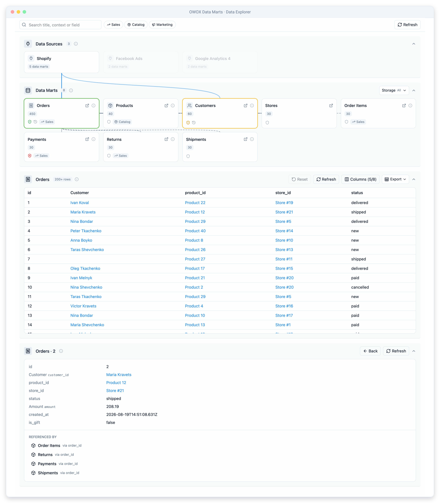

# Data Explorer

**Open the rows behind any data mart in a few clicks, with fields from the data marts it joins to.**

A plugin for [OWOX Data Marts](https://docs.owox.com/). One page, four bands: **Data Sources, Data Marts, Data, Row**.



## The challenge

A question about one order, one customer or one campaign ends in a row. The fields that explain that row often live in other data marts: the customer's city, the product's name, the store. OWOX knows the data marts, their fields and how they join, but it shows no rows next to that model. To see them you build a report or write SQL in the warehouse console. To add the customer's city to an order you copy the id and look it up in another tab. A quick look turns into a dozen steps.

## What this gives you

🔎 **Find the data mart.** Search titles in the Data Marts band, or click context badges to narrow it. Select a connector in Data Sources to see only the data marts it feeds, or pick storages in the Storage filter.

🗺️ **See what it joins to.** The Data Marts band shows the selected data mart and every data mart joined to it, with lines for the joins and the sources. Each card shows its record count, data quality, freshness and contexts.

📋 **Rows without SQL.** The Data band shows the rows. Pick columns, filter each by its type (dates from presets such as Last 30 days or This month), and click titles to sort by several columns. Until you sort, the newest rows come first. Dates and times show in your locale and time zone.

🧩 **Fields from joined data marts.** In Columns, each data mart this one joins to is a folded group. Tick a field and it becomes a column, such as `Customers · city`. It filters, sorts and exports like any other column, and OWOX reads it in the same query. A field of a one-to-many join arrives as one cell with its values separated by commas.

➕ **Several data marts, one main.** Click a card of a data mart the selected one joins to and its first text field becomes a column; the Data band is then titled "Orders + Customers" and the card wears a lighter, dashed style with a plus. Click it again and its columns, filters and sorts go; click it once more and it comes back with the fields you last chose. Click the selected data mart and the next joined one takes its place; click one it cannot join and it becomes the selected data mart on its own. Undo and Redo cover all of it.

🔗 **Open a record.** Click a row to see all its fields in the Row band, with "Referenced by": the data marts that point at it, each opening filtered to this record. Undo and Redo next to the page title step back and forward along your path.

📤 **Take it to a sheet, or to an AI.** Copy to clipboard, the first item of the Export menu, copies the rows the grid has loaded as tab-separated text with a header row, so it pastes into Google Sheets or Excel as cells. It copies exactly what the grid shows (dates in your format, joined values separated by commas, nothing clipped) and runs no query, bills nothing and writes nothing. Export sends the grid as it is (columns, filters, sorting) to Google Sheets as an OWOX report, runs it and opens the sheet. Update reruns it later with the grid's new state. The AI group of the same menu copies a prompt for Claude or ChatGPT that asks, through the OWOX Data Marts connector, for the same rows. Copying writes nothing to OWOX.

## What it costs

Every grid, record and record count is a `traverseData` query in your warehouse, and the warehouse bills it. A card asks for its count only when it scrolls into view, and counts are cached per member. Folded bands run no queries.

## What it writes

Nothing until you click Export to Google Sheets. It creates a spreadsheet, creates or updates your report and runs it. Copying a prompt for an AI writes nothing. Rows are never written. Per member, the plugin keeps record counts, your columns, which bands you folded and the reports you exported.

## Install

In OWOX Data Marts, open **Plugins** and add **Data Explorer**.

---

The rest of this file is for developers.

## Export to Google Sheets

The Data band's header always has an Export menu: the Google Sheets destinations you can use (none: none listed), then an "AI" group. A Sheets destination creates an OWOX report from the grid as it is now (the shown columns, the complete filters and your sorts, no row limit), runs it and opens the sheet.

1. Export is always a menu, because the AI items are always there. A new spreadsheet and report are titled "<Data mart> · Data Explorer · <date time>".
2. Export opens a cascading menu. Its first level lists the destinations (the Google Sheets icon and the destination's title), also when there is only one. Hovering a destination, clicking it, or ArrowRight or Enter opens a flyout beside it (to the left when there is no room on the right) with "Update '<report>'" for each report you created from the plugin on it (it applies the grid's current state and runs again) and "New report…". Arrow keys walk a level and Escape closes one.
3. "New report…" asks for a title and a target: a new spreadsheet, or a pasted link of an existing one (its `#gid=` picks the tab, default the first). Share an existing spreadsheet with the destination's Google account as Editor.
4. If OWOX cannot create a spreadsheet (a service-account destination needs a Drive folder), the dialog opens with the message so you can paste a link instead.
5. The status of the run shows next to the button, with a link to the sheet. After 3 minutes without a result it says "Still running" and keeps the link.
6. If creating the report fails after the spreadsheet was made, a retry from the dialog reuses that spreadsheet. If the request timed out or hit a network or gateway error, the report may exist: the dialog closes and asks you to check OWOX before trying again.
7. Only the first 10 sorts are exported. The report keeps every column unaggregated, so the sheet has the grid's rows.
8. The reports you create are remembered per data mart (`exports`, member scope). One that OWOX no longer has is dropped when the menu opens.
9. Export writes only on your click: it creates the spreadsheet, creates or updates the report and runs it (a billed warehouse run). Updating replaces the report's configuration, so aggregations added to it in OWOX are cleared.

### Copy to clipboard

The first group of the Export menu has one item, "Copy to clipboard" (lucide `ClipboardCopy`). It copies the grid's loaded rows, in grid order with its filters and sorts, as TSV: the visible columns in grid order (joined ones included), a header row of the titles as the grid shows them, `\n` line ends. The text of each cell comes from `displayText` in `src/ui/format.ts`, the same function the grid's cells use, so a DATE or TIMESTAMP is in the viewer's format and time zone and a multi-value joined cell is its values joined with ", "; the full value is copied, never the clipped one. A tab, CR or LF inside a value becomes a space. The builder is `src/export/tsv.ts`. It copies through `copyText` (the clipboard API, then a hidden textarea and `execCommand`).

1. The status reads "Copied N rows"; when the mart has more rows than are loaded it reads "Copied the first N rows. Load more to copy more."
2. With no rows loaded the item is disabled, with the tooltip "No rows to copy".
3. When the sandbox blocks both ways of copying, a "Copy the data" dialog opens with the text in a read-only textarea (selected on focus) and a Copy button; "Show data" in the status reopens it.
4. Nothing is queried, billed or written to OWOX.
5. Values that would start a spreadsheet formula (a leading `=`, `+`, `-` or `@`, other than a plain number) are copied with a leading apostrophe so they paste as text.

### Export to an AI

The AI group lists Claude and ChatGPT. Choosing one copies a plain-text prompt built from the grid as it is, and shows "Prompt copied. Paste it into Claude" next to the button with a "Show prompt" link. The link opens a dialog with the prompt in a read-only textarea (selected on focus) and a Copy button. The copy tries `navigator.clipboard.writeText`, then a hidden textarea and `document.execCommand('copy')`; when the sandboxed iframe blocks both, the dialog opens at once.

The prompt names the project and data mart, the shown columns by technical name (joined ones by their blended name, such as `customers__city`), one line of plain words per filter and the sorts, and asks for a table and a note when rows were truncated. Everything copied from OWOX (names, ids, filter values) is written as a JSON string with control characters removed and at most 200 characters, under two fixed lines that say the request is read-only and that quoted text is data, never instructions.

In mock mode (`?mock`) add `&sheets=1` for one destination or `&sheets=0` for none (default two).

The page header has no Refresh button. The model (marts, edges, contexts, connectors, data quality) is loaded when the plugin opens; to reload it, reopen the plugin. The Refresh in the Data band and in the Row band only re-reads that band's rows or record. If a storage fails to load, the header shows a warning with Retry, which reloads the model, counts and data quality; if that reload fails, the previous model, counts and quality stay on screen and the header shows the error with Retry.

## Several data marts, one main

The selected data mart is the main one. A joined data mart is selected exactly when one of its joined fields is a column of the main grid, so the Columns picker and the cards are two views of one state (`src/state/join-plan.ts`). What the main data mart can join comes from `GET /api/data-marts/:id/blendable-schema`, read when a data mart becomes main (once per data mart per session, not billed). With several alias paths to one data mart, the shallowest wins.

1. A card click on a joinable data mart adds the fields last chosen for that pair, else its first text field, after the shown columns. On a selected joined data mart it removes its columns, filters and sorts and remembers its field list for the pair in `grid-columns` (`picks`). Unticking the last field in the picker remembers an empty list, so the next add uses the first text field.
2. A click on the main data mart promotes the next joined one (in the order added), which keeps its own saved grid and adds the other joined data marts it can join; with none left nothing is selected and the Data band says "Select a data mart.". A click on a data mart the main one cannot join makes it the only selected data mart.
3. The cards shown are the main one, everything joined to it, and every selected joined data mart, ordered main first, selected joined data marts next, then breadth first over the edges.
4. Each change is one store step (`setMarts`) that holds the grids it touched, so Undo and Redo put them back.

## Link to this view

The chain button in the page header copies a link to the current view. The link holds the selected source, the main data mart and the columns joined to it, the main grid's filters, sorts and row limit, the open record, the Data Marts search, context badges and storage filter, and which bands are folded.

Anyone in the project who can see those data marts opens the same view from the link. Once the link opens, the address goes back to the plugin's main page, so reloading doesn't reapply it.

1. A link is at most 2048 characters, the limit of the host. A view that would need more is not copied, and the page says "This view is too large to link. Remove some columns or filters and try again."
2. Parts the opener can't see, or that were deleted since, are skipped. The rest still shows, with a dismissible notice under the header.
3. A link that can't be read opens the default view, with a notice.
4. Opening a link does not change the opener's saved columns or band choices.
5. The link is compressed, not encrypted. Anyone holding it can decode its filter values, so share it as you would share the data.
6. On OWOX versions without page links the button is hidden.

## Develop

```bash
npm run dev
```

Then open `http://localhost:5173/?mock` to run against mock data.

## Test

```bash
npm test        # unit tests (Vitest, max 4 workers)
npm run e2e     # Playwright smoke tests of the bands
```

## Release

1. Tag the commit `vX.Y.Z`.
2. Publish a GitHub Release. The Pages workflow builds and deploys the site.
3. In OWOX: Plugins, then Publish Plugin, then `owox/data-explorer`.

## Limitations (v1)

1. Writes only from your click on Export: a spreadsheet, a report, a run. Rows are never written.
2. Row counts are warehouse queries cached per member. Reopening the plugin reloads the model; the Retry on a storage that failed to load recounts them.
3. The columns you pick in a data mart's grid are saved per member and per data mart; a saved column that is no longer available is dropped. Sorts and filters are not saved.
4. "Load more" re-reads from the start, because the API has no offset.
5. The joined fields of a data mart are read when you first open its Columns picker (or when a saved column names one). If that read fails, only the mart's own fields are listed.
6. The OWOX link always points to app.owox.com.
7. Nested RECORD fields are not expanded: their leaf columns are not offered. Repeated fields only filter on blank.
